# W68 办公室第二版验收

代码分支：`wi/68-office-world-switch`。全部截图与 GIF 来自真实世界舞台；事件段连接临时 SQLite API，使用返回的 apiKey 心跳。

## 坐满检查

### panorama-1440x900.png

白天 1440×900 全景：世界以 1 倍整数像素居中，正面视角一致，工作区、会议室、休息区和前台都可辨认。

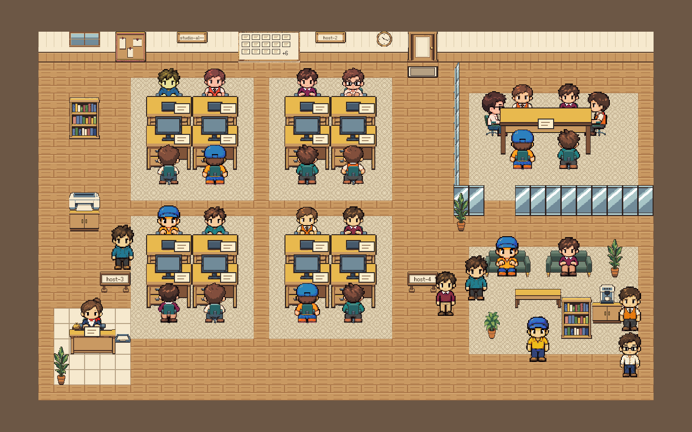

### panorama-1x.png

白天 1280×768 世界全景：人物脚底与座位统一，桌卡落在工作面上；六个站位未遮住沙发坐人。

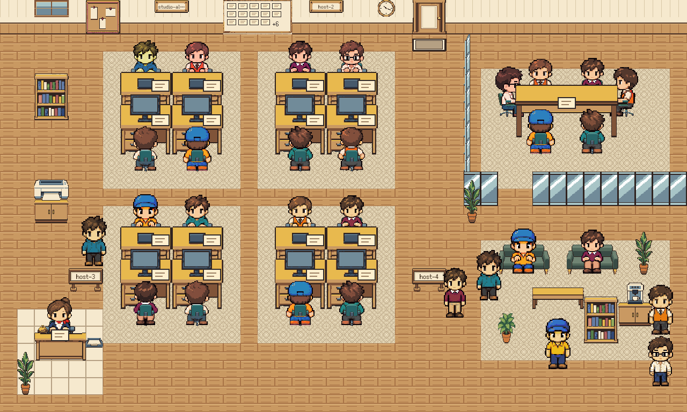

### panorama-dusk.png

黄昏（hour=7）：暖色色块覆盖地板、北墙、板卡和家具，地图外没有着色溢出。

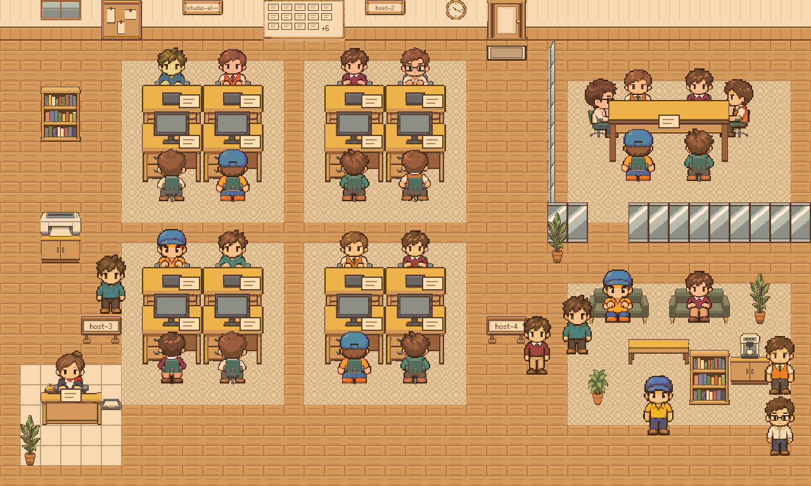

### panorama-night.png

夜间（hour=22）：北墙与人物一起变暗；16 张工位桌、会议桌、前台柜台的暖光固定在各自 workSpot，沙发与站位无光。

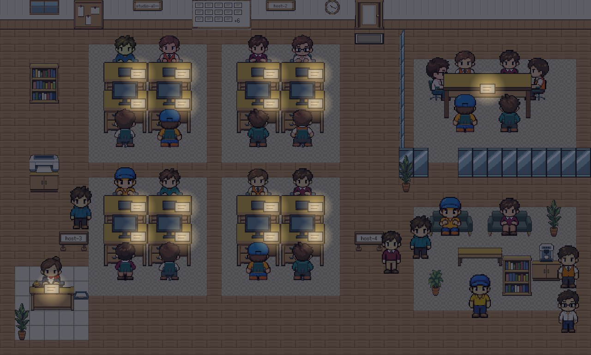

### zone-1@3x.png

工作区一：北排朝下，双手在桌面前沿，桌子遮住胸以下；南排朝上，椅背遮住腰背，显示器完整露在头顶上方，脚落在椅脚附近。长主机名缩小并截断。

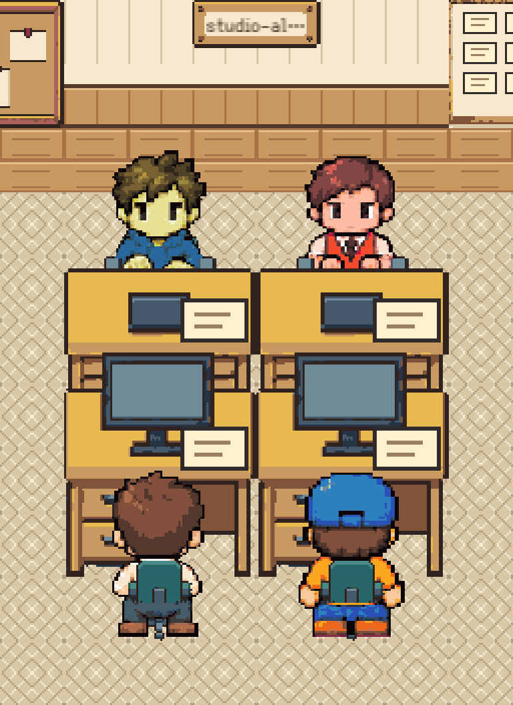

### zone-2@3x.png

工作区二：两位北排人物的手在桌沿，桌体盖住下半身；南排背影与椅背前后正确，头未盖住显示器。

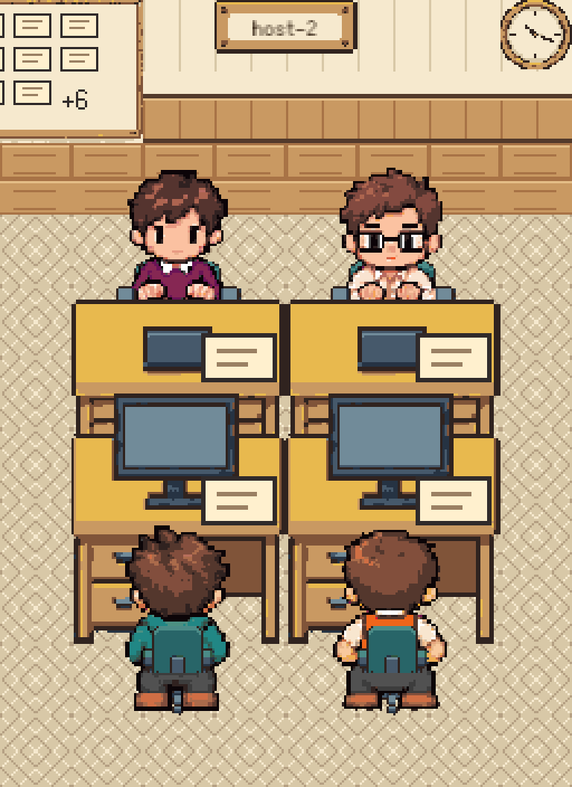

### zone-3@3x.png

工作区三：北排打字与坐姿共用同一落点，桌卡不跟人一起抬高；南排双脚低于椅座，立式名牌文字位于牌面。

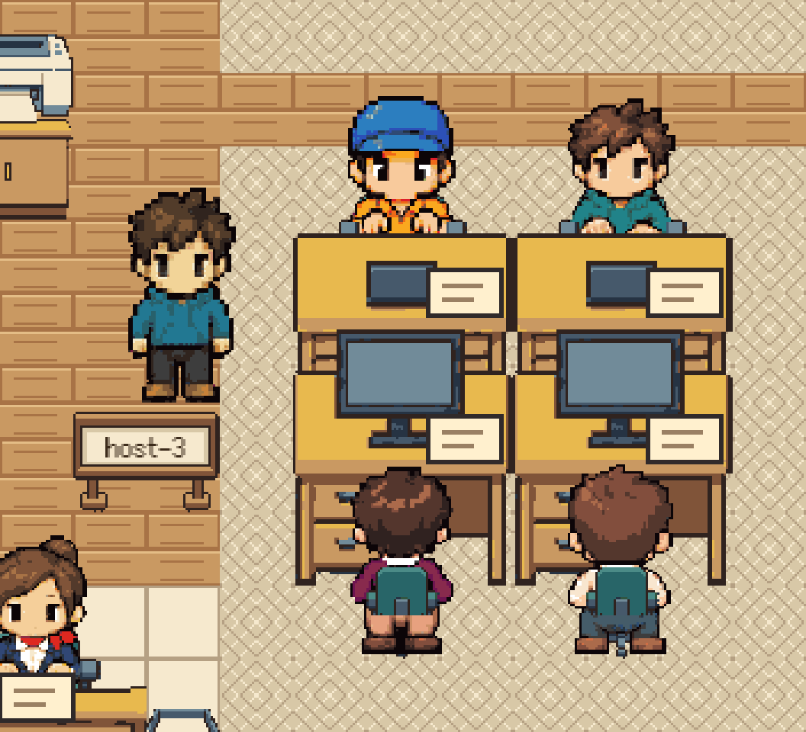

### zone-4@3x.png

工作区四：北排桌体遮住腿，南排椅背覆盖腰背；过道站人按脚底排序，没有骑在桌面或名牌上。

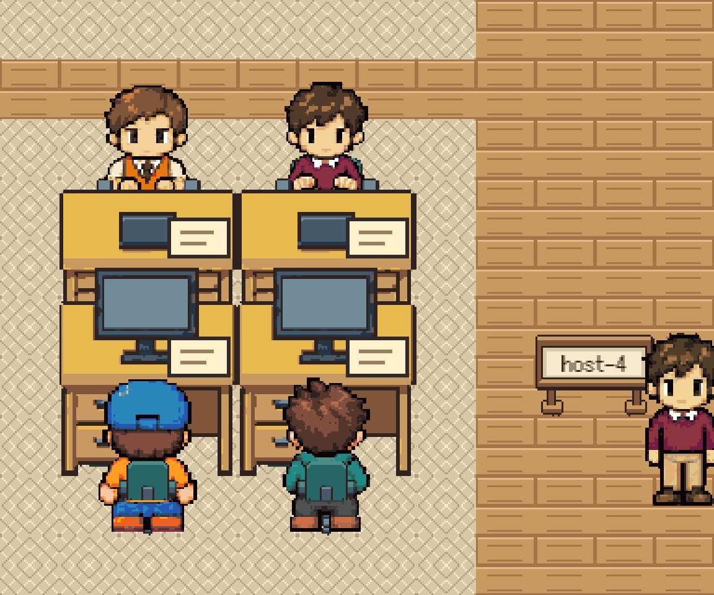

### reception@3x.png

前台：礼仪正面坐着，双手伸到柜台上沿，柜台自然遮住腿；任务卡位于柜台中部，文件筐在右侧。

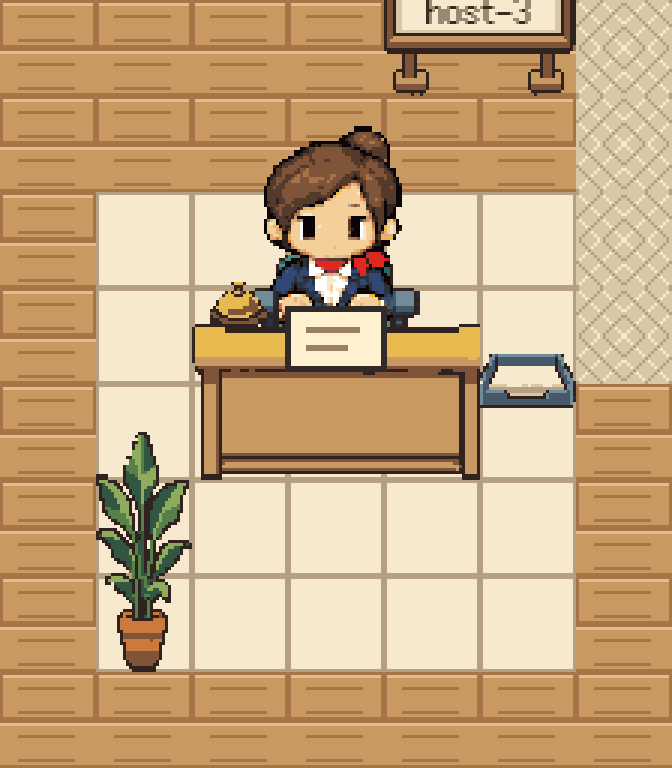

### meeting@3x.png

会议室：北侧朝下、南侧朝上，两端侧坐均靠扶手落座；西侧人朝右、东侧朝左，手贴近桌沿，近侧扶手盖住腿部边缘。桌卡在桌面中央。

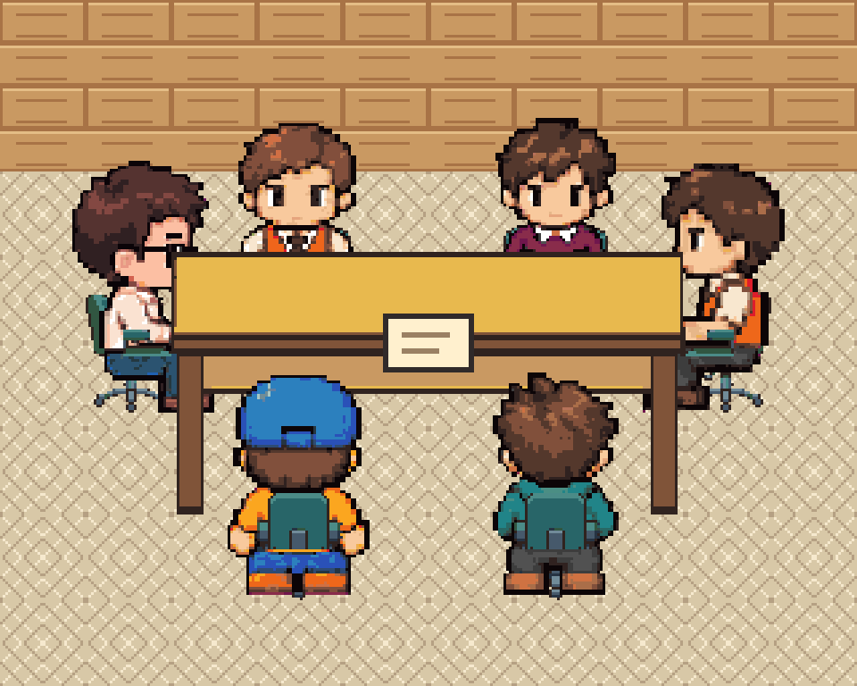

### lounge@3x.png

休息区：两张沙发的靠背在人后，扶手和前沿在人前；人坐在坐垫上、脚垂在沙发前，没有站位遮住坐人的脸。

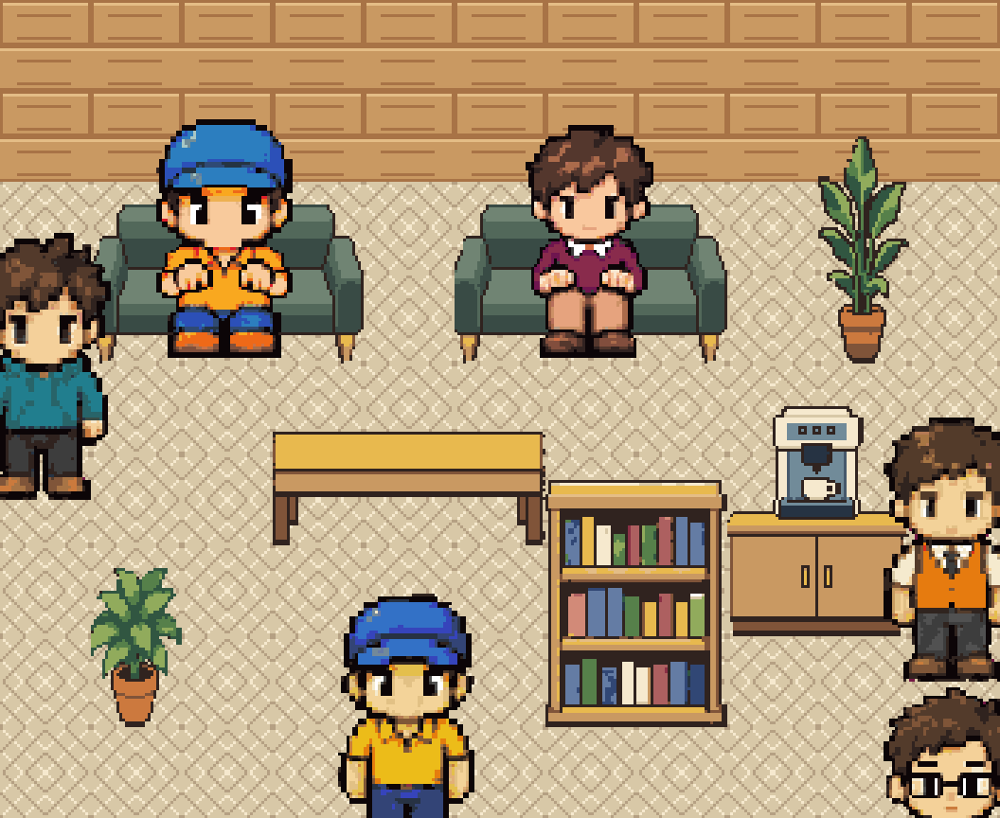

### entrance@3x.png

入口：门与地垫保持正面格子视角，门前的命名点位于可走格，进入后可通往各区。

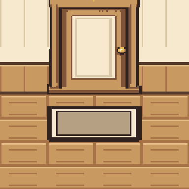

### north-wall@3x.png

北墙：板卡采用半倍像素，从 textArea 排出 14 张和 +6；墙上名牌文字在名牌精灵之上，长名截断仍在框内。

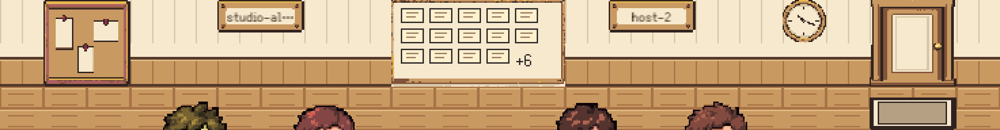

### side-chairs@3x.png

侧椅对照：直接从 sprites.png 取真帧，左右坐姿与椅子镜像一致；扶手覆盖近侧腿部，椅背在身体后。

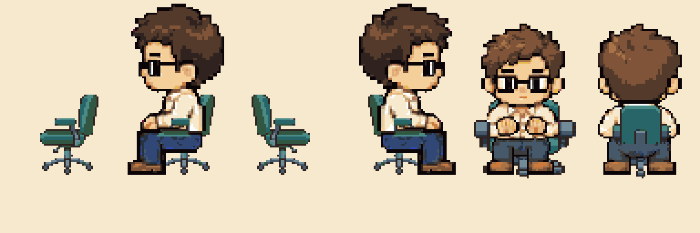

## 第一眼复核

所有家具、地面和角色保持正面俯视，四区桌椅排列一致，卡片没有漂浮在人物头顶或桌外。主过道保留通行空间，右下站位与沙发分开；下部横向空地是前台与休息区之间的通路，整体没有失衡的大块闲置空间。会议室西侧玻璃顶端已止于北墙墙裙下沿，未改美术帧。

## 命令证据

见 [validation](validation/)；根目录测试 944 个通过，office 402 个通过，lint 0 warnings。旧引用扫描结果为空，按协调者确认，仅排除 `apps/api/src/http/office.test.ts`：该文件两处旧场景 URL 是删除路由的回归断言（未托管 404、托管时 SPA 回退）。

## 事件、空闲与交互

- [上线](events/online.gif)、[建任务](events/created.gif)、[领取](events/claim.gif)、[接受](events/accept.gif)：从门入场，去白板领卡，持卡回座打字。
- [汇报](events/reported.gif)、[交接](events/handoff.gif)、[完成](events/complete.gif)：气泡、桌边递卡、纸屑与飞入文件筐。
- [暂停](events/pause.gif)、[恢复](events/resume.gif)、[释放](events/release.gif)：去休息点喝咖啡，回座放卡，或把卡送回白板。
- [满员会议](events/meeting.gif)、[六人同时落座](events/six-seated.png)、[散会](events/disband.gif)：最后一个 join 触发入会；六张椅子上均有角色和省略号，桌面一张卡，取消后各回原位。
- [信封](events/envelope.gif)、[广播](events/broadcast.gif)、[下线](events/offline.gif)：分别飞到接收者桌面或公告栏，presence 超时后走回门口消失。
- [空闲 60 秒](events/idle-60s.gif)：8–12 秒面对面聊天，40–56 秒走到咖啡 spot 停留冒泡，另有张望和小动作；共享 moving 集合限制最多两人同时走。未修改随机数或增加运行时开关。
- [点击人物](ui/person-profile.png)、[点击礼仪](ui/reception-profile.png)、[点击板卡](ui/task-card.png)、[回放](ui/replay.png)、[回现场](ui/back-to-live.png)、[窄屏与 reduced motion](ui/narrow-reduced-motion.png)。

检查页、完整事件录制、会议补录、交互测试的浏览器错误均为 0。详细复现命令见 W68 PR 描述。
